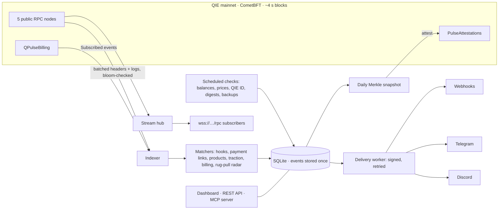

<p align="center">
  
</p>

<h1 align="center">Q-Pulse</h1>

<p align="center">
  <b>The event layer for QIE Blockchain.</b><br>
  Real-time webhooks, Telegram and Discord alerts, payment links, products that unlock things,<br>
  pay-per-request APIs and on-chain-provable traction, for apps, people and AI agents.
</p>

<p align="center">
  <a href="https://qpulse-production.up.railway.app/#/p/q-pulse"></a>
  <a href="https://github.com/drained69/pulse/actions/workflows/ci.yml"></a>
  <a href="https://qpulse-production.up.railway.app/#/status"></a>
  <a href="LICENSE"></a>
  
</p>

<p align="center">
  <a href="https://qpulse-production.up.railway.app"><b>Live app</b></a> ·
  <a href="https://qpulse-production.up.railway.app/#/guide">Guide</a> ·
  <a href="https://qpulse-production.up.railway.app/#/docs">Docs</a> ·
  <a href="https://qpulse-production.up.railway.app/#/status">Network status</a> ·
  <a href="https://qpulse-production.up.railway.app/#/explore">Leaderboard</a> ·
  <a href="https://t.me/QPulseAlertsBot">Telegram bot</a> ·
  <a href="docs/ARCHITECTURE.md">Architecture</a>
</p>

---

**In one sentence:** Q-Pulse watches the QIE blockchain and tells your app, Telegram or Discord within seconds when something you care about happens, such as a payment, a transfer or a contract event.

## Contents

- [Why Q-Pulse](#why-q-pulse)
- [Live on QIE mainnet](#live-on-qie-mainnet)
- [Try it in 60 seconds (no wallet needed)](#try-it-in-60-seconds-no-wallet-needed)
- [Features](#features)
  - [Hooks: alerts and webhooks](#hooks-alerts-and-webhooks)
  - [Payment links](#payment-links)
  - [Products: sell anything, unlock anything](#products-sell-anything-unlock-anything)
  - [Pay-per-request APIs (HTTP 402)](#pay-per-request-apis-http-402)
  - [Provable traction pages](#provable-traction-pages)
  - [WebSocket RPC: `eth_subscribe` for QIE](#websocket-rpc-eth_subscribe-for-qie)
  - [AI agents (MCP server)](#ai-agents-mcp-server)
  - [Scam guards](#scam-guards)
- [Quick start (hosted)](#quick-start-hosted)
- [Integration guide](#integration-guide)
- [Architecture](#architecture)
- [Security](#security)
- [Trust model: who holds which key](#trust-model-who-holds-which-key)
- [Smart contracts](#smart-contracts)
- [Plans and limits](#plans-and-limits)
- [Self-hosting](#self-hosting)
- [Development and tests](#development-and-tests)
- [Known limitations](#known-limitations)
- [Roadmap](#roadmap)
- [QIE integration](#qie-integration)
- [Documentation](#documentation)
- [License](#license)

---

## Why Q-Pulse

To know that a payment arrived or a contract was called, an app needs the chain to *tell* it. On QIE, it can't:

- QIE's public RPC nodes reject `eth_subscribe` (*"notifications not supported"*), so `watchContractEvent` in viem and `contract.on()` in ethers don't work.
- Filter ids (`eth_newFilter`) live on a single node and break behind the five load-balanced public nodes.
- The explorer has a query API but no webhooks.

So every QIE dApp writes, hosts and babysits its own polling loop, and a shop still doesn't know its customer has paid. **Q-Pulse is that loop, done once, done properly, and shared**: one indexer reads every QIE block, and everything else (alerts, payments, products, traction, real-time RPC, AI-agent tools) is built on top of it.

| | |
|---|---|
| 🪪 **Built on QIE ID** | Watch `shop.qie`, not a hex address. Senders appear by their QIE ID. Names resolve through the official QIE ID contracts (via the QIE Wallet MCP) and are re-checked every 10 minutes, so a repointed name is followed. |
| ⚡ **Fast and measured** | QIE produces a block every ~4 s with CometBFT instant finality. The status page shows live p50/p95/p99 latency from the block timestamp to WebSocket push, to detection and to webhook delivery. |
| 🔏 **Nothing missed, nothing twice** | Every event is stored before delivery. A restart resumes from the last fully stored block; duplicates are dropped; a lagging node is detected (logs-bloom check) and the range retried elsewhere instead of skipped. |
| 🛡️ **Safe by default** | Signed webhooks, SSRF protection, anti-phishing text sanitising, lookalike-token and address-poisoning warnings, a rug-pull radar. |
| ✅ **Provable** | Each project's traction is committed on chain daily as a Merkle root; anyone can recount it from QIE's explorer and verify it without trusting us. |

**Why on chain?** Q-Pulse's input *is* the chain: it reads every QIE block. Two things are deliberately on chain rather than in a database: **billing** (users pay in QUSDC to `QPulseBilling`, which forwards straight to the treasury and is the record that unlocks Pro: no card processor, no custody) and **traction proofs** (`PulseAttestations` makes each day's numbers tamper-evident: we can't quietly change a project's history, and anyone can check it). Everything else that benefits from being fast and cheap (matching, delivery, retries) stays off chain.

---

## Live on QIE mainnet

| | |
|---|---|
| Dashboard and API | **https://qpulse-production.up.railway.app** |
| WebSocket RPC | `wss://qpulse-production.up.railway.app/rpc` |
| MCP server (AI agents) | `https://qpulse-production.up.railway.app/api/mcp` |
| Telegram bot | [@QPulseAlertsBot](https://t.me/QPulseAlertsBot) |
| `QPulseBilling` (verified) | [`0x16D687505037a0A3E2B882F2bBa45E772807BEde`](https://mainnet.qie.digital/address/0x16D687505037a0A3E2B882F2bBa45E772807BEde) |
| `PulseAttestations` (verified) | [`0x4A6AcE957b37378D1F9BA917dE131E9f203A4967`](https://mainnet.qie.digital/address/0x4A6AcE957b37378D1F9BA917dE131E9f203A4967) |
| Network | QIE mainnet, chain id `1990` |

Both contracts were deployed in one transaction batch with [`contracts/script/DeployAll.s.sol`](contracts/script/DeployAll.s.sol) at block 12057730, and their source is verified on the QIE explorer. The server runs on Railway in US East, next to QIE's public RPC nodes.

**On-chain evidence:** the first daily traction proof ([`0x79df…c767`](https://mainnet.qie.digital/tx/0x79df0cab62e59a6350c34f67ef035624cbfcd22e5c8ef92ae256fc0973ebc767), 5 projects) and every one after it, the attester rotation ([`0x1ac1…25e2`](https://mainnet.qie.digital/tx/0x1ac141582ba7040e7a558ca2e22956f838528417e8695b02338c315cfebf25e2)), and the deployments. The full list and the project's development history are in [docs/BUILD_LOG.md](docs/BUILD_LOG.md).

### Try it in 60 seconds (no wallet needed)

1. **Watch it run:** open the [status page](https://qpulse-production.up.railway.app/#/status): the latest indexed block, all five QIE RPC nodes, live latency.
2. **Check a project's numbers without trusting us:** open a [traction page](https://qpulse-production.up.railway.app/#/p/patungan) and press **Verify in your browser**: your browser recounts the numbers from QIE's explorer and checks them against the root on chain. Or from a terminal: `pnpm verify-traction patungan --api https://qpulse-production.up.railway.app`.
3. **Use `eth_subscribe` on QIE**, which the public nodes refuse:
   ```bash
   cast block-number --rpc-url wss://qpulse-production.up.railway.app/rpc
   ```
4. **Sign in** with QIE Wallet or MetaMask (free, no transaction), pick a template such as **Rug-pull radar**, choose Telegram or Discord, and press **Send test**.

---

## Features

### Hooks: alerts and webhooks

A **hook** watches QIE for one thing and tells one destination. Create hooks in the dashboard, with the REST API, the SDK, or from an AI agent.

**Per-block triggers** (fire seconds after the transaction):

| Trigger | Event | Fires when |
|---|---|---|
| `payment` | `payment.received` | Native QIE (successful transactions only) or a listed ERC-20 lands at a `name.qie` or address. Optional minimum amount. Zero-value transfers never count. |
| `token_transfer` | `token.transfer` | A token moves, filtered by sender, recipient and minimum (e.g. "QUSDC ≥ 10,000" whale alerts). |
| `swap` | `dex.swap` | A trade on a QIEDEX pair, decoded (token in/out, amounts) with a USD value; optional minimum size. |
| `contract_event` | `contract.event` | Any of up to 12 Solidity event signatures, from one contract or all, decoded, with argument filters. |
| `wallet` | `wallet.activity` | Anything in or out of an address: QIE and token transfers, contract calls, deployments, and **failed transactions**. Address poisoning is flagged. |
| `invoice` | `invoice.paid` | One of your payment links or products is paid. |
| `liquidity` | `liquidity.drop` | **Rug-pull radar**: a QIEDEX pair's liquidity falls a chosen share (default 30%) below its 24-hour peak. Fires once, re-arms after recovery. |

**Scheduled triggers** (checked every minute; thresholds fire once on crossing and re-arm when they clear):

| Trigger | Event | Fires when |
|---|---|---|
| `balance` | `balance.threshold` | A QIE or token balance goes below or above an amount (e.g. a relayer's gas wallet runs low). |
| `price` | `price.threshold` | A token's QIEDEX USD price crosses a level. |
| `name_watch` | `name.changed` | A `name.qie` starts pointing to a different address or stops resolving (takeover warning). |
| `daily_digest` | `digest.daily` | Once a day: event count, totals per token and top counterparties of another hook (e.g. daily sales). |

**Destinations:** signed **webhook** (HTTPS POST) · **Telegram** (private chat, group or channel, linked with a one-time code) · **Discord** (channel webhook). No-code tools (Zapier, Make, n8n) work through their "catch webhook" triggers.

**One-click templates** (`#/hooks/new/<id>`, handy to share in community channels):

| For | Templates |
|---|---|
| Merchants | Payment link paid · Shop payments · Daily sales summary |
| Developers | Low gas wallet · Contract admin changes (paused, upgraded, ownership, roles) · Failed calls to my contract |
| Treasuries and security | Watch my Safe (QIE Safe v1.3 and v1.4) · Token approvals · Watch my .qie name · Watch a wallet · Address poisoning guard |
| Traders and community | QUSDC whale moves · New QIEDEX pairs · Rug-pull radar · WQIE price alert |

### Payment links

A hosted checkout (`#/pay/<id>`) for an exact amount of **QUSDC, QIE or WQIE**. The customer pays with QIE Wallet in one click or scans an EIP-681 QR code with any wallet; funds go **straight to you** (your wallet, your `name.qie` or a Safe): Q-Pulse never holds money.

- QIE transfers carry no memo, so when several links for the same amount are open, each gets a few extra millionths (`25.000001 QUSDC`) and the payment is matched on **recipient + token + exact amount**.
- A payment arriving up to 24 hours after its link expired is still credited; a payment mined *before* a link existed never settles it; cancelled links keep their amount reserved so a late payment can't settle a newer link.
- Attach your own `metadata` (e.g. an order id) and a `successUrl`; get `invoice.paid` with both the moment it confirms.

### Products: sell anything, unlock anything

A **product** is a permanent link and QR code (`#/buy/<id>`) for something sold again and again: a file, a licence key, a coffee, a locker, an API credit.

- **A fresh checkout per buyer.** Opening the link creates that buyer's own 15-minute payment link with a unique amount, so matching still needs no memo.
- **Unlock content.** After paying, the buyer sees the product's unlock content (a download link, licence key or door code) on the checkout page, and only then.
- **Devices.** Each sale fires `invoice.paid` with `data.product`, so a machine can act. [`examples/device-receiver`](examples/device-receiver) is a dependency-free receiver for a Raspberry Pi or any computer: it verifies the signature, acts once per payment and switches a relay.
- **Device view** (`#/device/<id>`): a screen with the QR code and a lock that opens live when the product is paid, for demos and kiosks.

```ts
const p = await qp.products.create({ name: "Locker 1", amount: "0.5", unlockContent: "Door code 4812" });
// p.url → print it as a QR code; p.deviceUrl → open it on the machine's screen
```

### Pay-per-request APIs (HTTP 402)

Charge people and AI agents **per API call in QUSDC** with one middleware:

```ts
import express from "express";
import { QPulse, paywall } from "qpulse-sdk";

const qp = new QPulse({ apiKey: process.env.QPULSE_KEY! });
const app = express();

app.get("/forecast", paywall({ client: qp, id: "forecast", amount: "0.05" }), (req, res) => {
  res.json({ forecast: "sunny" });
});
```

1. A request without payment gets **`402 Payment Required`** with a payment link (and `Link` / `X-QPulse-Payment-Url` headers).
2. The caller pays it with any QIE wallet and repeats the request with `X-QPulse-Payment: inv_…`.
3. The middleware checks that the link was made **by this paywall, at this price**, and is paid, then redeems it atomically (`POST /api/invoices/:id/redeem`). **One payment buys exactly one request**; a used payment, or a cheaper link from elsewhere, is refused with a fresh payment link.

Not on Node? Use the two endpoints directly: `POST /api/invoices` to ask for payment, `POST /api/invoices/:id/redeem` to consume it (`402` not paid yet, `409` already used).

### Provable traction pages

Any project gets a public, live page (`#/p/<slug>`) and a README badge showing how many transactions and distinct wallets use its contracts: counted live by the indexer, with the last 90 days imported from the QIE explorer.

- **Hard to fake:** returning wallets, failed transactions and top-10 wallet concentration sit next to the totals; shared QIE infrastructure (QUSDC, WQIE, WETH, the QIEDEX router and factory) can't be listed by anyone but its deployer.
- **Verified owners:** pages created or claimed from a contract's deployer (or its `owner()`) are marked **Verified**. Anyone may create a page; the team can take it over by signing in.
- **Leaderboard** (`#/explore`): public pages ranked by distinct wallets over the last 7 days.

**Provable, not just visible.** Once a day Q-Pulse commits every project's 30-day numbers to the chain:

1. At the indexer's cursor (every block up to it is fully stored), each project becomes a leaf: its slug, contracts, window (30 days up to block N), successful-transaction count, distinct wallets, and a hash of the **exact set of transaction hashes**.
2. The leaves form a Merkle tree (double-hashed leaves, sorted pairs: the OpenZeppelin convention); the root goes to `PulseAttestations`, which is append-only (each day once, in order, never in the future).
3. Anyone checks a page without trusting Q-Pulse: recount the numbers from QIE's own explorer, hash them into a leaf, fold the proof, and compare with the root read from a QIE node. The traction page does it in the browser (**Verify in your browser**), and so does the CLI:

```bash
pnpm verify-traction patungan --api https://qpulse-production.up.railway.app
# ✓ transaction count matches the chain  claimed 8, recounted 8
# ✓ wallet count matches the chain  claimed 4, recounted 4
# ✓ exact transaction set matches
# ✓ recounted numbers fold into the snapshot's Merkle root  0xcfb4a317…592520
# ✓ RPC is the expected chain  chain 1990
# ✓ root is posted on chain  0x4A6AcE95…4967 at 2026-11-21T08:30:14.000Z (5 projects)
# ✓ on-chain root equals the recomputed root  0xcfb4a317…592520
# ✓ on-chain snapshot block matches the window  12062606
# ✓ PulseAttestations.verify(epoch, leaf, proof) returns true
#
# All checks passed: these numbers are on chain and match QIE's own explorer.
```

If the server dropped or invented a single transaction, the transaction-set hash would differ and the proof would no longer reach the on-chain root.

### WebSocket RPC: `eth_subscribe` for QIE

`wss://qpulse-production.up.railway.app/rpc` is a drop-in JSON-RPC endpoint (HTTP or WebSocket) that adds what QIE's public nodes lack:

```ts
import { createPublicClient, webSocket } from "viem";

const client = createPublicClient({ transport: webSocket("wss://qpulse-production.up.railway.app/rpc") });
client.watchContractEvent({ address: QUSDC, abi, eventName: "Transfer", onLogs: console.log }); // just works
```

| Method | Where it is answered |
|---|---|
| `eth_subscribe("newHeads")`, `eth_subscribe("logs", { address, topics })`, `eth_unsubscribe` | WebSocket only, by the stream hub |
| `eth_newFilter`, `eth_newBlockFilter`, `eth_getFilterChanges`, `eth_getFilterLogs`, `eth_uninstallFilter` | HTTP or WebSocket. Filters live in Q-Pulse, so polling clients (viem `http()`) work across all five nodes. Unpolled filters expire after 5 minutes. |
| `eth_chainId`, `net_version` | Answered locally |
| Every other `eth_*`, `net_*`, `web3_*` call | Forwarded to the RPC pool with failover. Signing and account methods are refused. |

**How it works:** one upstream poll fans each new block out to every subscriber; each poll is a single batch (head, next headers, their logs) answered by one node; a block is pushed only when its logs match its header's hash and logs bloom, so a lagging node never produces a silently empty block; CometBFT has no reorgs, so `removed` is always `false`. **Limits:** 20 connections and 25 requests/s (burst 100) per IP, 100 subscriptions per connection, 50 server-side filters per client, 256 KB messages, slow consumers (4 MB unread) are disconnected.

### AI agents (MCP server)

`/api/mcp` is a [Model Context Protocol](https://modelcontextprotocol.io) server (Streamable HTTP, stateless JSON) that gives Claude and other agents **16 tools** to take payments and react to QIE:

| Area | Tools |
|---|---|
| Payments | `create_payment_link`, `get_payment_link`, `wait_for_payment`, `list_payment_links` |
| Products | `create_product`, `list_products` |
| Alerts and events | `create_alert`, `list_alerts`, `set_alert_active`, `delete_alert`, `get_events`, `wait_for_event`, `list_telegram_chats` |
| Chain data | `resolve_qie_name`, `get_traction`, `network_status` |

```bash
claude mcp add --transport http qpulse https://qpulse-production.up.railway.app/api/mcp \
  --header "Authorization: Bearer qp_live_…"
```

Then ask: *"Create a 5 QUSDC payment link for the logo design and tell me when it's paid."* The two `wait_for_*` tools long-poll for up to 90 s, so "wait until the customer pays" is a single tool call. Batches are capped at 20 calls and 5 concurrent waits per account.

### Scam guards

- **Address poisoning.** Scammers send zero-value or dust transfers from an address that starts and ends like one you use (wallets often show only `0x1234…abcd`), hoping you copy it from your history. Wallet and payment alerts carry a ⚠️ warning, and webhooks a `data.security` object, when a counterparty imitates an address the hook has seen before, or when a token transfer is worth zero.
- **Rug-pull radar.** The `liquidity` trigger follows a QIEDEX pair's depth, √(reserve0 × reserve1), through every `Sync` event. Swaps barely move it; removing liquidity does. It alerts once when depth falls a chosen share below its 24-hour peak.
- **Lookalike tokens.** Hooks match tokens by contract address (official QUSDC and WQIE by default, or tokens you list), never by symbol; a token copying an official symbol is flagged in the payload.
- **Phishing-safe alerts.** Text that strangers control (token symbols, string event arguments, reverse-resolved names) is reduced to plain text before it reaches Telegram or Discord, so a fake token or a contract event can't put a clickable link into your alerts.

---

## Quick start (hosted)

1. **Sign in** at https://qpulse-production.up.railway.app with QIE Wallet or MetaMask. It's a signature (EIP-4361 style): free, and no transaction is sent.
2. **Pick a destination.** Telegram: account menu → **Telegram** → **Connect** and press **Start** in the bot. Discord: in your channel, ⚙️ **Edit Channel → Integrations → Webhooks → New Webhook → Copy Webhook URL**. Or use your own HTTPS endpoint.
3. **Create a hook** from a template (Hooks → **New hook**) and press **Send test**.
4. **For code and agents:** account menu → **API keys** → create a key (shown once) and use it with the SDK, the REST API or the MCP server.

---

## Integration guide

### Webhook request

Every delivery is an HTTPS `POST` with a JSON body and these headers:

| Header | Value |
|---|---|
| `QPulse-Signature` | `v1=<hex HMAC-SHA256 of "{timestamp}.{raw body}" with the hook's secret>` |
| `QPulse-Timestamp` | Unix seconds when signed (reject anything older than 5 minutes) |
| `QPulse-Event-Id` | The event id (`evt_…`); use it to make your handler idempotent |
| `QPulse-Event-Type` | e.g. `payment.received` |

```json
{
  "id": "evt_5c1f0e7b2a9d4e31a6b8c0d2",
  "type": "payment.received",
  "createdAt": "2026-11-21T13:05:42.118Z",
  "hook": { "id": "hk_…", "name": "Shop payments" },
  "chain": { "id": 1990, "network": "mainnet" },
  "tx": { "hash": "0x…", "blockNumber": 12062730, "logIndex": 3, "timestamp": 1795262742, "explorerUrl": "https://mainnet.qie.digital/tx/0x…" },
  "data": {
    "from": { "address": "0xF1cB…c17a", "name": "alice.qie" },
    "to": { "address": "0x1720…b174", "name": "shop.qie" },
    "token": { "address": "0x3F43DA82eC9A4f5285F10FaF1F26EcA7319E5DA5", "symbol": "QUSDC", "decimals": 6, "official": true },
    "amount": { "raw": "25000000", "formatted": "25", "display": "25 QUSDC", "symbol": "QUSDC", "valueUsd": 25 }
  }
}
```

Scheduled events have `tx: null` and a `link` instead. Failed deliveries are retried at 10 s, 1 min, 5 min, 30 min, 2 h and 6 h (7 attempts over ~8.5 hours); any event can be replayed from the dashboard or `POST /api/events/:id/replay`. Delivery is at-least-once: key your handler on `QPulse-Event-Id`.

### Verify a signature

```ts
import { verifyWebhook } from "qpulse-sdk";

app.post("/qie-webhook", express.raw({ type: "application/json" }), (req, res) => {
  const event = verifyWebhook({ body: req.body, headers: req.headers, secret: process.env.QPULSE_SECRET! }); // throws if invalid
  if (event.type === "payment.received") markPaid(event.data.from.address, event.data.amount.raw);
  res.sendStatus(200);
});
```

Any language works: compute `HMAC-SHA256(secret, timestamp + "." + rawBody)`, compare it in constant time with the `v1=` value, and check the timestamp is within 5 minutes. A Python example is on the Docs page.

### SDK (`qpulse-sdk`)

```bash
npm install qpulse-sdk   # published from packages/sdk; until it is on npm, build it from the repo
```

```ts
import { QPulse } from "qpulse-sdk";

const qp = new QPulse({ apiKey: process.env.QPULSE_KEY! }); // defaults to the hosted server; pass baseUrl for your own

await qp.onPayment("shop.qie", { url: "https://shop.example.com/qie-webhook" }, { minAmount: "1" });
const link = await qp.invoices.create({ amount: "25", description: "Order #1001", metadata: { orderId: "1001" } });
const paid = await qp.invoices.waitForPayment(link.id);
```

| Area | Methods |
|---|---|
| Hooks | `hooks.list/get/create/update/pause/resume/delete/rotateSecret/test/events`, `events.replay`, shortcuts `onPayment`, `watchWallet` |
| Payment links | `invoices.create/get/list/cancel/redeem/waitForPayment` |
| Products | `products.list/get/create/update/delete` |
| Pay-per-request | `paywall(options)` middleware, `checkPayment(options, paymentId)` for other frameworks |
| Webhooks | `verifyWebhook`, `signWebhook` |
| Other | `traction.get/leaderboard`, `resolve(name)` |

### REST API

Base URL `https://qpulse-production.up.railway.app/api`, authenticated with `Authorization: Bearer qp_live_…` (or the dashboard's session cookie).

| Method | Path | Purpose |
|---|---|---|
| `GET` `POST` | `/hooks` | List or create hooks: `{ name, trigger: { type, config }, channel: { type, config } }` |
| `GET` `PATCH` `DELETE` | `/hooks/:id` | Read, update (e.g. `{ active: false }`) or delete a hook |
| `POST` | `/hooks/:id/test` · `/hooks/:id/rotate-secret` | Send a test event · rotate the signing secret |
| `GET` | `/hooks/:id/events` | Recent events with delivery status |
| `POST` | `/events/:id/replay` | Deliver an event again |
| `GET` `POST` | `/invoices` | List or create payment links: `{ amount, token?, description?, recipient?, expiresInMinutes?, metadata?, successUrl? }` |
| `GET` | `/invoices/:id` | A payment link, with the payment once paid |
| `POST` | `/invoices/:id/cancel` · `/invoices/:id/redeem` | Cancel an open link · use a paid link up once (`402` unpaid, `409` used) |
| `GET` `POST` | `/products` | List or create products: `{ name, amount, token?, description?, unlockContent?, recipient? }` |
| `GET` `PATCH` `DELETE` | `/products/:id` | Read, update or pause, delete a product |
| `GET` `POST` `PATCH` `DELETE` | `/my/projects[/:id]` | Manage your traction pages |
| `GET` | `/me` · `/billing` | Account, plan and usage · Pro payments |
| `DELETE` | `/me` | Delete the account and everything it owns (dashboard session only, confirmed with the wallet address) |

Public, no key needed:

| Method | Path | Purpose |
|---|---|---|
| `GET` | `/pay/:id` | Public status of a payment link (what the checkout polls) |
| `GET` · `POST` | `/shop/:id` · `/shop/:id/buy` | Product page data · open a fresh checkout (rate-limited) |
| `GET` | `/projects` · `/projects/:slug` · `/projects/:slug/badge.svg` · `/projects/:slug/proof` | Leaderboard · stats · README badge · Merkle proof |
| `GET` | `/attestations` · `/status` · `/resolve?name=shop.qie` · `/pairs` | On-chain snapshots · indexer and RPC health · QIE ID lookup · QIEDEX pairs |

---

## Architecture



| Part | What it does | Where |
|---|---|---|
| RPC pool | Sends each call to the fastest healthy node; probes all five every 15 s; demotes a node that answers with missing logs or receipts | `apps/server/src/rpc.ts` |
| Indexer | Reads blocks in batches of 25 (every header plus all logs, from one node), proves completeness with logs blooms, matches, stores, then advances its cursor | `apps/server/src/indexer.ts` |
| Hook index | In-memory map of active hooks, so matching a log is a lookup, not a loop | `apps/server/src/triggers.ts` |
| Delivery | Webhook (SSRF-checked), Telegram, Discord; backoff and give-up on permanent errors | `apps/server/src/delivery.ts` |
| Payment links and products | Unique-amount matching, unlock content, redeem-once | `invoices.ts`, `products.ts` |
| Stream hub and gateway | `eth_subscribe`, server-side filters, forwarding | `apps/server/src/stream.ts` |
| Attestations | Daily snapshot → Merkle root → `PulseAttestations`; proofs per page | `attestations.ts`, `attest-core.ts` |
| Dashboard | React + Vite single-page app served by the same container | `apps/web` |

**Guarantees.** Exactly-once storage and at-least-once delivery: the cursor only moves after a block range's events are committed, and events are unique per `(hook, tx hash, log index)`. QIE nodes store a block before their log index catches up, so the indexer asks one node for every header of a range plus all its logs and checks each header's logs bloom: a block whose bloom says "has logs" with none returned (or a missing block or receipt) means that node is behind, so the range is retried on another node instead of skipped. More detail in [docs/ARCHITECTURE.md](docs/ARCHITECTURE.md).

---

## Security

| Risk | What Q-Pulse does |
|---|---|
| A lagging node hides a payment | Logs-bloom completeness check; the range is retried on another node, never skipped |
| Webhooks aimed at internal networks (SSRF) | Private, loopback, link-local, CGNAT and metadata ranges blocked when saving and again at connect time (no DNS rebinding); redirects not followed |
| Forged or replayed webhooks | HMAC-SHA256 over timestamp and body, constant-time comparison, 5-minute window |
| Stolen database | API keys and session tokens stored only as SHA-256 hashes; Discord webhook URLs masked in the dashboard |
| Sign-in replay | Single-use nonce, 10-minute expiry, EIP-4361-style message bound to the domain and chain |
| Cross-site requests | `HttpOnly`, `SameSite=Lax` session cookie; cross-origin writes rejected; strict Content-Security-Policy and `X-Frame-Options: DENY` |
| Phishing through alerts | Token symbols, string event arguments and reverse-resolved names reduced to plain text |
| Abuse | Per-IP rate limits behind the proxy's real-IP header, 64 KB request limit, per-plan quotas, caps on filters, links, products, projects and agent long-polls |
| Money | Contracts and payment links never hold funds; the billing payer sets a maximum price; payment links can't be settled by a transfer mined before they existed |

The code went through a full security review before launch; the fixes (completeness check, anti-phishing sanitising, payment-link reservation, filter caps and others) are covered by regression tests.

---

## Trust model: who holds which key

Q-Pulse never holds anyone's money or wallet keys. Three keys exist, and here is exactly what each can and cannot do:

| Key | Can | Cannot |
|---|---|---|
| **Contract owner** (deployer wallet) | Change the Pro price and period ([`setPlan`](contracts/src/QPulseBilling.sol#L99)), the treasury ([`setTreasury`](contracts/src/QPulseBilling.sol#L109)) and the attester ([`setAttester`](contracts/src/PulseAttestations.sol#L131)); hand ownership over in two steps | Move anyone's funds: neither contract holds any. Overcharge a payer: [`subscribe`](contracts/src/QPulseBilling.sol#L63) reverts above the payer's `maxAmount`. Change or delete a past traction root |
| **Attester** (server hot wallet, holds only gas) | Post one traction root per day ([`attest`](contracts/src/PulseAttestations.sol#L61)) | Rewrite or backdate a day: epochs are append-only, in order, never in the future. Make a false number stick: anyone can recount from QIE's explorer and the proof stops matching (`verify-traction`) |
| **Server** | Read the chain, match events, deliver alerts, keep accounts | Spend user funds: payment links and products pay the merchant's own address directly. Read API keys or sessions: stored only as hashes |

Trusted parts, stated plainly: the attester is a team key, so the *posting* is trusted while the *numbers* are checkable; prices come from the QIEDEX API and `.qie` names from the QIE Wallet MCP. Moving contract ownership to a QIE Safe multisig is on the roadmap.

---

## Smart contracts

Solidity 0.8.24, `evm_version = paris` (QIE has no `PUSH0`), Foundry, 20 tests including fuzzing.

**[`QPulseBilling`](contracts/src/QPulseBilling.sol)**: pay for Pro in QUSDC. `subscribe(planId, periods, maxAmount)` (or `subscribeFor` a team wallet or a Safe) pulls QUSDC straight to the treasury and emits `Subscribed(account, planId, periods, amount, paidUntil)`; the server reads those events to unlock the plan. The contract never holds funds, renewals stack, the payer caps the price, and ownership is two-step.

**[`PulseAttestations`](contracts/src/PulseAttestations.sol)**: append-only daily Merkle roots of every project's traction numbers. Only the attester key (a hot key holding only gas) can post; each epoch once, in order, never in the future. `verify` and `verifyStats` let anyone (or another contract) check a project's numbers against the root. The owner can rotate the attester ([`RotateAttester.s.sol`](contracts/script/RotateAttester.s.sol)).

```bash
cd contracts && forge test
TREASURY=0x… ATTESTER=0x… forge script script/DeployAll.s.sol --rpc-url qie --broadcast --account <keystore>
```

Use a Foundry keystore (`cast wallet import <name> --interactive`); never put a private key on a command line.

---

## Plans and limits

| | Free | Pro |
|---|---|---|
| Price | $0 | **9 QUSDC / 30 days**, paid on chain through `QPulseBilling` (renewals stack) |
| Hooks | 10 | 100 |
| Events per month | 5,000 | 200,000 |
| Everything else | All triggers, destinations, payment links, products, traction pages, RPC, MCP | Same |

Event history is kept for 30 days. Rate limits: 300 API requests per minute per IP; 30 sign-in attempts per minute; 10 product checkouts per 10 minutes per visitor and product; RPC limits as listed above.

---

## Self-hosting

**Requirements:** Node ≥ 22.18 (runs TypeScript directly), pnpm, a persistent disk, and a host that keeps the process running (no scale-to-zero: the indexer must always run). Foundry for the contracts.

### Configuration

Copy [`.env.example`](.env.example) to `.env`. The most important settings:

| Variable | Default | Purpose |
|---|---|---|
| `PUBLIC_URL` | `http://localhost:8787` | **Required in production.** Used in sign-in messages, links and cookie security |
| `DB_PATH` | `./qpulse.db` | SQLite file; put it on a persistent volume |
| `QIE_NETWORK` · `RPC_URLS` | `mainnet` · the five public nodes | Network and RPC endpoints |
| `TELEGRAM_BOT_TOKEN` · `TELEGRAM_BOT_USERNAME` | empty | Telegram bot from [@BotFather](https://t.me/BotFather) (long polling, no public webhook needed) |
| `BILLING_CONTRACT` · `BILLING_START_BLOCK` | empty | Enables Pro; the start block lets the server import payments made before it first ran |
| `ATTESTATION_CONTRACT` · `ATTESTER_PRIVATE_KEY` | empty | Posts daily traction roots on chain (snapshots are computed either way) |
| `PUBLIC_ALERTS_CHAT_ID` · `PUBLIC_ALERTS_MIN_QUSDC` | empty · `1000` | Optional public channel of large QUSDC transfers and new QIEDEX pairs |
| `FREE_MAX_HOOKS` · `FREE_MONTHLY_EVENTS` · `PRO_MAX_HOOKS` · `PRO_MONTHLY_EVENTS` | `10` · `5000` · `100` · `200000` | Plan limits |
| `CLIENT_IP_HEADER` | `fly-client-ip` on Fly, `x-real-ip` on Railway | Real client IP for rate limits (only behind a proxy that sets it) |
| `BACKUP_DIR` · `BACKUP_KEEP` | `backups/` next to the database · `7` | Daily consistent database copies (`VACUUM INTO`) |
| `EVENT_RETENTION_DAYS` | `30` | How long events and their delivery logs are kept |
| `MAX_BLOCKS_PER_BATCH` · `POLL_INTERVAL_MS` · `CHECK_INTERVAL_MS` | `25` · `1500` · `60000` | Indexer and scheduler pacing |

All settings, with defaults, are in [`apps/server/src/config.ts`](apps/server/src/config.ts).

### Docker (any host)

```bash
docker build -t qpulse .
docker run -d -p 8787:8787 -v qpulse-data:/data --env-file .env qpulse
```

Serve it behind HTTPS. One container runs the indexer, delivery worker, Telegram bot, scheduler, API, WebSocket RPC and dashboard.

### Railway (what the live deployment uses)

```bash
railway init --name qpulse
railway add --service qpulse --variables "DB_PATH=/data/qpulse.db" --variables "PORT=8787" --variables "RAILWAY_RUN_UID=0"
railway service link qpulse
railway service scale us-east=1                 # one region, next to QIE's RPC nodes
railway volume add --mount-path /data           # volumes are root-owned, hence RAILWAY_RUN_UID=0
railway domain --port 8787
railway variable set PUBLIC_URL=https://<your-domain> --skip-deploys
railway up --detach --service qpulse
```

Set secrets without echoing them, e.g. `… | railway variable set TELEGRAM_BOT_TOKEN --stdin`. Step-by-step instructions for Railway, Fly.io and Docker, including deploying your own contracts, are in [docs/SELF_HOSTING.md](docs/SELF_HOSTING.md).

### Fly.io

```bash
fly launch --no-deploy --copy-config            # fly.toml is included (region ewr)
fly volumes create data --size 1 --region ewr
fly secrets set PUBLIC_URL=https://<your-app>.fly.dev BILLING_CONTRACT=0x… BILLING_START_BLOCK=<block>
fly deploy
```

### Backups

The server writes one consistent copy of the database per day to `BACKUP_DIR` and keeps the newest `BACKUP_KEEP`. They live on the same volume, so download one regularly for an off-site copy (`railway volume files`, `fly ssh sftp`).

---

## Development and tests

```
apps/server         Indexer, delivery, Telegram bot, scheduler, REST API, MCP server, WebSocket RPC,
                    payment links, products, attestations (Node 22+, Hono, node:sqlite, viem)
  bin/verify-traction.ts   Check a traction page against the chain without trusting the server
apps/web            Dashboard, checkout, product and device pages (React + Vite)
packages/sdk        qpulse-sdk: typed client, webhook verification, pay-per-request middleware
contracts           QPulseBilling.sol, PulseAttestations.sol, deploy and rotation scripts (Foundry)
examples            device-receiver: unlock a device when a product is paid
scripts             e2e-fork.sh, seed-traction.mjs
docs                Architecture, self-hosting, build log, brand assets
```

```bash
pnpm install
cp .env.example .env               # optional: TELEGRAM_BOT_TOKEN, BILLING_CONTRACT, …
pnpm --filter @qpulse/web build
pnpm start                         # http://localhost:8787
```

For hot reload, run `pnpm --filter @qpulse/server dev` and `pnpm --filter @qpulse/web dev` (Vite on :5173 proxies `/api` to the server).

```bash
pnpm typecheck
pnpm test        # 108 server tests, 9 SDK tests, 20 contract tests (incl. fuzzing)
pnpm e2e         # end-to-end on an anvil fork of QIE mainnet
```

The **end-to-end test** forks QIE mainnet, deploys the billing contract, runs the whole server against the fork and sends real transactions: QUSDC and native QIE payments to `qie.qie`, a whale transfer, a QIEDEX swap through the real router, token approvals, a Pro subscription and a deliberately reverting call. It checks every webhook's signature and content, that a payment below the minimum does not fire, that the reverted call is reported as failed, that thresholds fire once, that prices come live from QIEDEX, that the on-chain payment unlocks Pro, that the transfers settle their payment links, that the traction page counts the calls, and that replaying every block after a restart creates no duplicates.

Other suites worth knowing: `stream.test.ts` drives the WebSocket RPC with real viem clients against a fake node that can lag or serve headers before logs; `attestations.test.ts` deploys `PulseAttestations` on anvil, anchors a snapshot and runs `verify-traction` against an honest and a tampered explorer; `hardening.test.ts`, `poisoning.test.ts` and `liquidity.test.ts` cover the security review fixes and scam guards.

---

## Known limitations

- **Internal QIE transfers** (QIE sent *by a contract*, e.g. a Safe payout or a DEX unwrap) aren't detected: QIE's public nodes offer no trace API. Token transfers from contracts are detected.
- **One instance.** SQLite on one volume keeps operations simple; for high volume the same schema moves to Postgres with several indexer workers.
- **External services.** `.qie` names come from the QIE Wallet MCP and USD prices from the QIEDEX API; when either is down, alerts still go out (names fall back to addresses, prices to none), and name watches skip a round rather than raise a false alarm.

---

## Roadmap

- Native Slack destination and email digests
- Subscriptions in QUSDC for any merchant (generalising `QPulseBilling`), with renewal reminders
- Proof of reserves: daily on-chain attestation of a treasury's balances, next to traction
- Validator monitoring for QIE's CometBFT validators (jailing, missed blocks, commission changes)
- Postgres and horizontally scaled indexer workers; a hosted free tier for the whole ecosystem

---

## QIE integration

Q-Pulse is built on QIE's own building blocks. How deep each one goes:

| Component | How Q-Pulse uses it | Where |
|---|---|---|
| QIE mainnet RPC (all 5 nodes) | Indexes every block with health probes, failover and completeness checks; serves `eth_subscribe` on top | [`rpc.ts`](apps/server/src/rpc.ts), [`indexer.ts`](apps/server/src/indexer.ts), [`stream.ts`](apps/server/src/stream.ts) |
| QUSDC | Payments, payment links, products, pay-per-request, Pro billing in a custom contract | [`invoices.ts`](apps/server/src/invoices.ts), [`products.ts`](apps/server/src/products.ts), [`QPulseBilling.sol`](contracts/src/QPulseBilling.sol) |
| QIE ID | Watch `name.qie` instead of addresses, show senders by name, re-resolve every 10 min, takeover alerts | [`names.ts`](apps/server/src/names.ts), [`hooks.ts`](apps/server/src/hooks.ts), [`checks.ts`](apps/server/src/checks.ts) |
| QIEDEX | Live USD prices, decoded swaps, new-pair feed, rug-pull radar from `Sync` events | [`tokens.ts`](apps/server/src/tokens.ts), [`triggers.ts`](apps/server/src/triggers.ts), [`liquidity.ts`](apps/server/src/liquidity.ts) |
| QIE Wallet | Sign-in (EIP-4361 style, EIP-6963 discovery), one-click payments, Pro checkout | [`wallet.ts`](apps/web/src/wallet.ts), [`auth.ts`](apps/server/src/auth.ts), [`Pay.tsx`](apps/web/src/pages/Pay.tsx) |
| QIE explorer | 90-day history import, deployer verification, and the independent recount behind every traction proof | [`projects.ts`](apps/server/src/projects.ts), [`attest-core.ts`](apps/server/src/attest-core.ts) |
| QIE Wallet MCP | `.qie` name resolution and reverse lookup | [`names.ts`](apps/server/src/names.ts) |

## Documentation

| Document | For |
|---|---|
| [Guide](https://qpulse-production.up.railway.app/#/guide) | Step-by-step use for shops, holders, communities, project teams, developers and AI agents |
| [Docs](https://qpulse-production.up.railway.app/#/docs) | Triggers, payloads, signatures, REST API, MCP and WebSocket RPC reference |
| [docs/ARCHITECTURE.md](docs/ARCHITECTURE.md) | How the system works and why it is built that way |
| [docs/SELF_HOSTING.md](docs/SELF_HOSTING.md) | Run your own server and contracts |
| [contracts/README.md](contracts/README.md) | The two contracts, their functions and trust model |
| [packages/sdk/README.md](packages/sdk/README.md) | `qpulse-sdk` reference |
| [docs/BUILD_LOG.md](docs/BUILD_LOG.md) | Development timeline, on-chain milestones and how AI was used |
| [SECURITY.md](SECURITY.md) · [CONTRIBUTING.md](CONTRIBUTING.md) | Reporting vulnerabilities · contributing |

## License

[MIT](LICENSE) © 2026 Q-Pulse contributors
