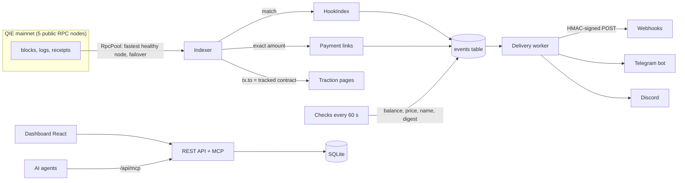

# How Q-Pulse works

This is the guide to read before the judges' demo. It explains every part of the system, why it is built that way, and the questions judges are likely to ask.

**Size:** about 4,800 lines of server TypeScript, 3,700 lines of dashboard, 560 lines of SDK and contract code. 83 automated tests plus a full end-to-end test on a fork of QIE mainnet.

---

## The one-paragraph version

QIE's public RPC nodes can't push events to apps (`eth_subscribe` returns "notifications not supported"), so every QIE dApp has to poll the chain itself to learn that something happened. Q-Pulse does that polling once, for everyone: an **indexer** reads every new QIE block, **matches** its transactions and logs against the users' hooks, **stores** each match as an event, and a **delivery worker** sends it to a webhook, Telegram or Discord, signing and retrying as needed. On top of that pipeline sit three products: **payment links** (a checkout page whose payment is detected by the same indexer), **traction pages** (the indexer counts transactions to a project's contracts) and an **MCP server** (AI agents use all of it as tools).



---

## The pieces (all in `apps/server/src`)

| File | What it does | One thing to remember |
|---|---|---|
| `main.ts` | Builds all services and starts the loops | `buildServices()` wires everything; tests reuse it |
| `config.ts` | Reads settings from environment variables | Every limit is configurable (plans, retention, timeouts) |
| `db.ts` | SQLite schema and migrations (`node:sqlite`, no native deps) | Migrations run in order on start; WAL mode |
| `rpc.ts` | **RpcPool**: talks to the 5 QIE RPC nodes | Probes each node every 15 s; sends calls to the fastest healthy one; marks a node down if it fails or is >5 blocks behind |
| `indexer.ts` | **The heart.** Reads blocks in batches of up to 200 | Cursor only moves after a batch is fully stored, so a crash replays it; duplicates are dropped by a unique key |
| `triggers.ts` | Trigger types (zod schemas) and **HookIndex**, the in-memory lookup of active hooks | Built once per change, so matching a log is a map lookup, not a loop over hooks |
| `payload.ts` | Turns a match into the JSON event users receive, and the human text for Telegram/Discord | Looks up `.qie` names of senders but never waits more than 1.5 s |
| `hooks.ts` | Create / update / delete hooks, validation, recording events | `recordEvent` is the single place an event is stored and a delivery queued |
| `delivery.ts` | Sends events: webhook, Telegram, Discord | Retries at 10 s, 1 m, 5 m, 30 m, 2 h, 6 h; gives up early on permanent errors (bot kicked, webhook deleted) |
| `signing.ts` | HMAC-SHA256 signatures for webhooks | Signature covers `timestamp.body`; receivers reject anything older than 5 minutes |
| `ssrf.ts` | Stops webhooks from reaching private networks | Checks the address when saving **and** again at connect time (blocks DNS rebinding) |
| `checks.ts` | Scheduled triggers every 60 s: balance, price, name change, daily summary; cleans old data hourly | Thresholds fire once on crossing, then re-arm (no spam) |
| `names.ts` | QIE ID (`.qie`) resolution through the QIE Wallet MCP | Cached 10 min; if the resolver is down, uses the last known answer |
| `tokens.ts` | Token metadata and QIEDEX prices | Prices from the official QIEDEX API, refreshed every 60 s |
| `invoices.ts` | **Payment links** | Matching by recipient + token + exact amount (see below) |
| `projects.ts` | **Traction pages** | Live counting + 90-day explorer import + leaderboard + badge |
| `stream.ts` | **WebSocket JSON-RPC** at `/rpc`: `eth_subscribe`, server-side filters, forwarding | One batched poll per tick fans out to every subscriber; logs checked against header hash + bloom |
| `attestations.ts` + `attest-core.ts` | Daily traction snapshots → Merkle root → `PulseAttestations` on chain; proofs for each page | `attest-core.ts` is shared by the server, the browser "Verify" button and the CLI, so all three hash identically |
| `metrics.ts` | Latency samples: block timestamp → stream / detect / deliver | p50/p95/p99 over 24 h on the status page; catch-up after downtime is excluded |
| `mcp.ts` | **MCP server** for AI agents | Stateless JSON-RPC over HTTP, 14 tools, API-key auth |
| `auth.ts` | Sign-in with QIE Wallet (EIP-4361 message), sessions, API keys | Nonces are single-use and expire in 10 min; keys and sessions stored only as hashes |
| `billing.ts` | Free/Pro plans and quotas; reads the billing contract's `Subscribed` events | The plan is unlocked by an on-chain payment the server sees through its own indexer |
| `telegram.ts` | The Telegram bot (long polling) and `/link CODE` chat linking | No public webhook URL needed |
| `api.ts` | REST API (Hono) with rate limits, body-size limit, CSRF check | Public routes: status, leaderboard, traction, checkout; the rest need a session or API key |

Other parts:
- `apps/web`: the dashboard (React + Vite). Talks only to `/api`. The checkout page (`#/pay/…`) is standalone so customers don't see the dashboard.
- `packages/sdk`: `@qpulse/sdk`, a typed API client plus `verifyWebhook()` for receivers.
- `contracts/QPulseBilling.sol`: pay for Pro in QUSDC; funds go straight to the treasury; the contract never holds money.

---

## Life of an event (what to draw on a whiteboard)

1. **A customer pays `shop.qie` 25 QUSDC.** QIE finalises the block in 1–2 s.
2. **Indexer tick** (every 1.5 s): `eth_blockNumber`, then one `eth_getLogs` call for the new blocks, filtered to the event topics any hook cares about (here, ERC-20 `Transfer`).
3. **Match:** the log's `to` address is looked up in `HookIndex.paymentsByRecipient`. `shop.qie` was resolved to an address when the hook was created, and is re-checked every 10 minutes in case the owner repoints it.
4. **Payload:** amount decoded with the token's decimals, USD value from QIEDEX, sender's `.qie` name looked up (max 1.5 s wait), and a lookalike-token warning if the token copies an official symbol.
5. **Store:** `INSERT` into `events` with a unique `(hook_id, dedupe_key)` where the key is `txHash:logIndex`. If the same block is processed twice, the insert is ignored. A `deliveries` row is queued in the same transaction.
6. **Cursor moves** only after the whole batch is stored.
7. **Deliver:** the worker picks up the delivery, signs the body with the hook's secret, POSTs it (or sends the Telegram/Discord message), and records the status code and latency. On failure it schedules a retry.

**Guarantee in one sentence:** every matching event is stored exactly once and delivered at least once, so receivers should de-duplicate on `event.id`.

---

## The three newer products

### Payment links (`invoices.ts`)
- **Problem:** QIE transfers have no memo field, so how do you know *which* order a payment is for?
- **Answer:** each open link for the same recipient and token gets a unique amount. The first 25 QUSDC link asks for exactly 25; a second open one asks for 25.000001. The indexer matches recipient + token + exact amount. Up to 1,000 simultaneous links per amount.
- **Native QIE** is matched from the block's transactions, and only counted if the receipt says the transaction succeeded.
- **Late payments:** a payment up to 24 h after expiry is still credited, and amounts of recently expired links aren't reused, so a late payment can't be credited to the wrong link.
- **Notifications** reuse the whole hook pipeline: a hook of type `invoice` receives `invoice.paid` with the merchant's `metadata` (e.g. order id), signed and retried like any other event.
- The checkout page polls the public `GET /api/pay/:id` every 2 s and flips to "Paid". "Pay with QIE Wallet" sends an ERC-20 `transfer` (or a plain QIE transfer) of the exact amount.

### Traction pages (`projects.ts`)
- **What is counted:** every transaction sent directly to the project's contracts (`tx.to`). Successful ones count; failed ones are shown separately.
- **Live:** the indexer already fetches full blocks when needed; transactions to tracked contracts are written to `project_txs` (unique per project + tx hash, so replays don't double count).
- **History:** on creation, the last 90 days are imported from the QIE explorer API (Blockscout `/api/v2/addresses/{addr}/transactions?filter=to`), up to 5,000 transactions per contract.
- **Anti-gaming signals:** returning wallets (active on 2+ different days), and the share of transactions from the 10 busiest wallets. A project whose activity is 97% from 10 wallets shows that openly.
- **Verified badge:** the page was created by the contract's deployer (from the explorer) or its `owner()` (on-chain call).
- **Leaderboard:** ranked by distinct wallets in the last 7 days. **Badge:** an SVG served from `/api/projects/:slug/badge.svg`.

### MCP server (`mcp.ts`)
- MCP (Model Context Protocol) is the standard way AI assistants like Claude call external tools.
- Q-Pulse implements the Streamable HTTP transport in its simplest stateless form: each POST is a JSON-RPC request, answered with JSON. `initialize`, `tools/list`, `tools/call`, `ping`.
- 14 tools wrap the same services the REST API uses. Two are long-polling (`wait_for_payment`, `wait_for_event`, max 90 s), so an agent can say "wait until the customer pays" in one call.
- Tool errors are returned to the model as `isError: true` text, so it can correct itself (e.g. a wrong amount format).
- Tested with Anthropic's official MCP client SDK against the running server.

---

## Security decisions (judges like these)

| Risk | What Q-Pulse does |
|---|---|
| Webhook URL pointing at internal services (SSRF) | Private, loopback, link-local, metadata IP ranges blocked; checked again when connecting, so a domain can't switch to an internal IP later; redirects not followed |
| Forged webhooks | HMAC-SHA256 over timestamp + body, constant-time comparison, 5-minute replay window |
| Stolen database | API keys and session tokens are stored only as SHA-256 hashes |
| Sign-in replay | Single-use nonce, 10-minute expiry, EIP-4361 message bound to the domain and chain |
| Cross-site requests | Session cookie is `HttpOnly`, `SameSite=Lax`; writes from other origins rejected |
| Clickjacking / XSS | Content-Security-Policy, `X-Frame-Options: DENY`; Telegram messages HTML-escaped |
| Abuse | Rate limits per IP (spoof-resistant), 64 KB request limit, quotas per plan, caps on filters/links/projects |
| Fake tokens | Only official QUSDC/WQIE count for payments; lookalikes flagged |
| Billing contract | Never holds funds; two-step ownership; payer sets a maximum price; 12 tests incl. fuzzing |
| Attestation contract | Append-only (epochs strictly increase, none in the future, snapshot block must be in the past); double-hashed leaves block second-preimage proofs; attester key holds gas only and is rotatable; 6 tests incl. fuzzing |
| WebSocket RPC abuse | Per-IP connection cap and token bucket, 100 subscriptions per connection, 256 KB messages, slow readers dropped at 4 MB buffered, signing methods refused, filters expire after 5 min |

---

## Questions judges will probably ask

**"Why not just use `eth_subscribe`?"**
QIE's public RPC nodes reject it ("notifications not supported"), so Q-Pulse *adds* it: `wss://…/rpc` serves `eth_subscribe` from one shared poller, and stock viem/ethers code works unchanged. For anything that must not be missed (payments, webhooks), the cursor-based indexer with storage is still the right tool: subscriptions drop on reconnect; the indexer resumes from its cursor.

**"How fast is it?"**
Look at the status page: p50/p95/p99 from each block's on-chain timestamp to (a) WebSocket push, (b) detection, (c) webhook delivered. Most of the number is QIE itself: its public nodes serve a new block ~5 s after its timestamp and answer each request in ~1–2 s. That is why each stream poll is a single batched request, and why the server runs in Fly's `ewr` region next to QIE's nodes (DigitalOcean, New York area).

**"What happens if your server crashes mid-block?"**
The cursor only advances after a batch is fully stored. On restart the batch is processed again, and the unique key on events stops duplicates. The end-to-end test does exactly this and checks nothing is duplicated.

**"What if an RPC node goes down or lags?"**
`RpcPool` health-checks all five every 15 s, routes to the fastest healthy node, and marks a node down if it errors or falls more than 5 blocks behind. The end-to-end test starts with a dead node first in the list.

**"How do you handle chain reorganisations?"**
QIE uses CometBFT, which has instant finality: a block is final when produced, so there are no reorgs to unwind. `CONFIRMATIONS` defaults to 0; each indexer batch proves the answering node has the whole range (it must return the range's last header in the same batch as the logs).

**"How do payment links know which payment is which?"**
Unique amounts per open link (25, 25.000001, …), matched on recipient + token + exact amount. Explain the late-payment rule too.

**"Can't projects fake their traction numbers?"**
They can send transactions from their own wallets, but the page shows it: returning wallets, failed transactions, and the top-10-wallet share. The data comes from the chain, not from the project, and anyone can click through to the explorer.

**"And can't *you* (Q-Pulse) fake them?"**
Not without getting caught. Every day the numbers are committed on chain as a Merkle root (`PulseAttestations`, append-only: no rewriting or backdating). Each leaf includes a hash of the exact transaction set, so the browser "Verify" button and `pnpm verify-traction` recount from QIE's explorer, hash, fold the proof and compare with the root read from a QIE node. One dropped or invented transaction breaks it. The attester key only holds gas and can be rotated by the owner.

**"Why SQLite?"**
One process, no external database, easy to run anywhere; WAL mode handles concurrent reads. The schema is plain SQL and moves to Postgres for scale.

**"How does it make money?"**
Pro plan (more hooks and events) paid in QUSDC through the billing contract. The server unlocks Pro when its own indexer sees the `Subscribed` event, so billing runs on the product itself.

**"Which QIE components do you use?"**
QIE Wallet (sign-in, payments, EIP-6963), QIE ID (resolution, reverse lookup, takeover alerts), QUSDC (payments, billing), QIEDEX (prices, swaps, pairs), all five mainnet RPCs, the QIE explorer (links and history import), and the QIE Wallet MCP.

**"Did you use AI to write this?"**
The rules allow AI assistance as long as you understand and can maintain the code. Be ready to open `indexer.ts` and `invoices.ts` and walk through them; they're the two files judges are most likely to ask about.

---

## How to run and test

```bash
pnpm install
pnpm --filter @qpulse/web build
pnpm start                 # http://localhost:8787
pnpm test                  # 83 tests: server, SDK, contract
pnpm e2e                   # full run on a fork of QIE mainnet (needs Foundry)
```
